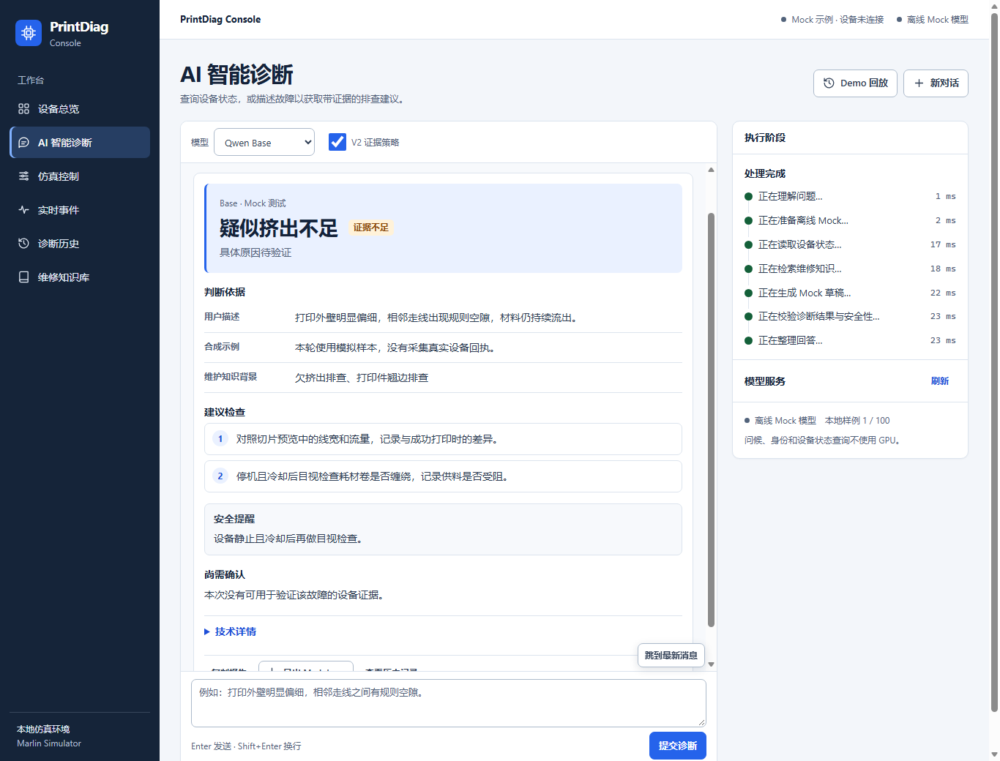
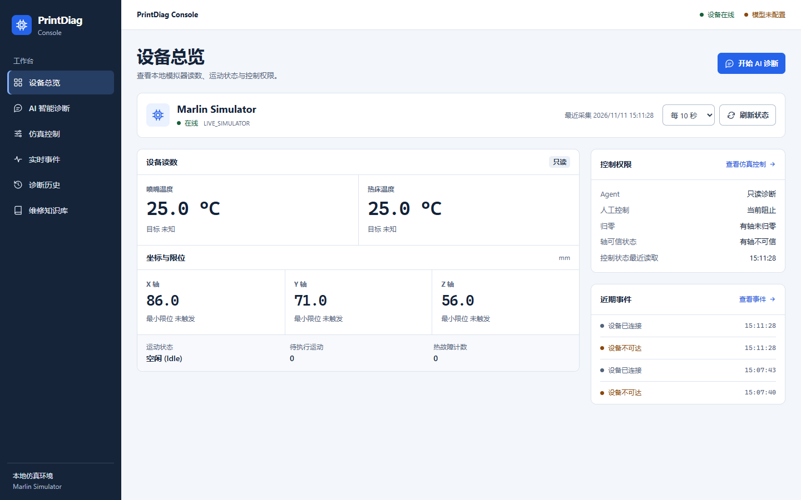
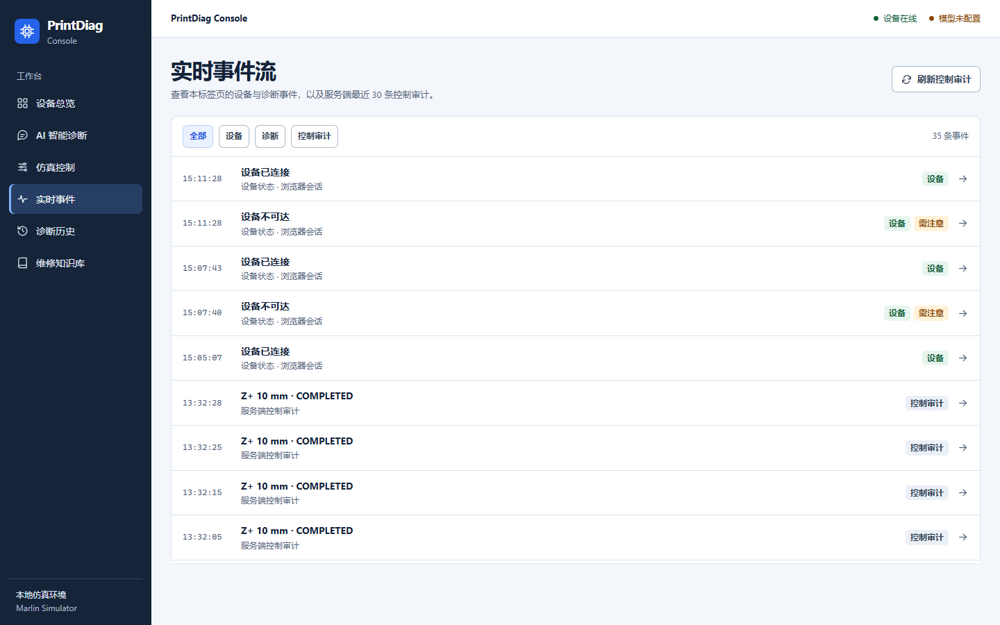
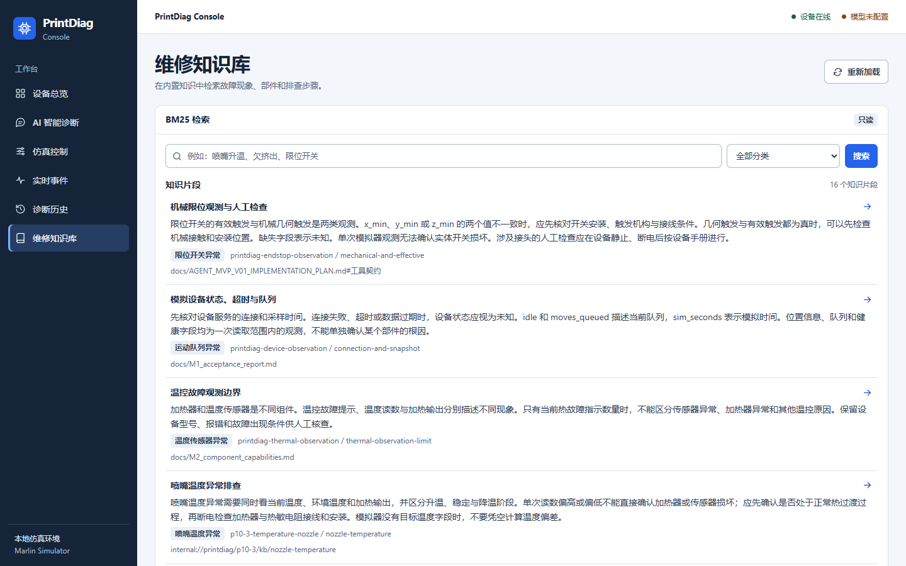
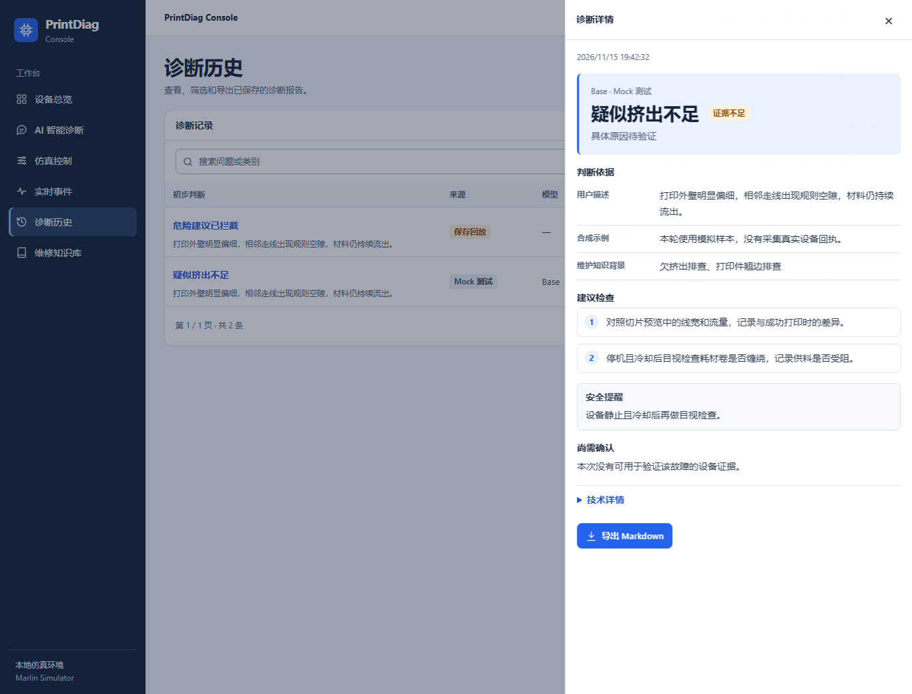
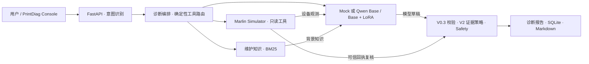

# PrintDiag-Agent V1

PrintDiag-Agent 是一个面向 FDM 3D 打印的诊断助手。输入「外壁线条偏细」「打印件发生层错位」等现象，系统会读取可用的设备状态、检索维修知识，并生成带依据的检查报告。报告会标明哪些现象来自用户、哪些来自设备，以及哪些原因还需要验证。

**V1 可以在无 GPU 环境下完整演示。** 公开版包含 Console、FastAPI、合成诊断回放、只读模拟器接入、SQLite 历史和 Markdown 导出。云端 Qwen 推理是独立的可选模式。

[五分钟离线演示](#五分钟离线演示) · [Console 功能截图](#console-功能截图) · [Marlin Simulator](#marlin-simulator) · [RTX 5090 微调与云端推理](#rtx-5090-微调与云端推理) · [V1 验证与后续方向](#v1-验证与后续方向)



*AI 智能诊断（离线 Mock）。用户描述和维修知识支持“疑似挤出不足”的初步判断。缺少设备回执时，正式状态保留为“证据不足”。*

## 五分钟离线演示

安装 Git 和 Python 3.13。在 Windows PowerShell 执行：

```powershell
git clone https://github.com/Dannyzhou0512/PrintDiag-Agent.git
Set-Location PrintDiag-Agent
py -3.13 -m venv .venv
.\.venv\Scripts\python.exe -m pip install -e ".[agent,dev]"
.\.venv\Scripts\python.exe -B scripts/run_console_demo.py --port 8010
```

打开 [AI 智能诊断](http://127.0.0.1:8010/console/diagnosis)，保持 **V2 证据策略**勾选，提交以下可复现示例：

> 打印外壁明显偏细，相邻走线出现规则空隙，材料仍持续流出。

1. 查看诊断报告中的判断依据、建议检查和待确认项。展开 **技术详情**可检查 RAG 引用及证据来源。
2. 在 **Demo 回放**选择 **Safety · 危险建议拦截**，查看发布层如何处理危险建议。
3. 进入 **诊断历史**查看报告，选择 **导出 Markdown**。演示每次启动使用独立的临时 SQLite。
4. 打开 **实时事件**回看本次采集、检索、校验与回放的过程，在 **维修知识库**搜索「欠挤出」或「限位开关」。

| 运行模式 | 设备数据 | 诊断来源 |
| --- | --- | --- |
| **离线 Demo** · `8010` | 合成示例，界面标明设备未连接 | 固定 Mock 草稿与安全回放，只需本地 Python |
| **Simulator 只读** · 示例 Console 端口 `8011` | 从已启动的本地 Marlin Simulator `8100` 读取 | 可查看实时读数和合成回放，模型生成关闭 |
| **云端模型** · 可选 | 可配置只读模拟器或审核后的合成夹具 | 由独立部署的 Qwen3.5-4B Base 或 Base + LoRA 生成草稿 |

[完整演示及 Simulator 启动命令](docs/DEMO_GUIDE.md) · [安装与测试复现](docs/REPRODUCIBILITY.md)

## Console 功能截图

诊断与历史使用公开版的合成 Demo。设备总览、仿真控制、实时事件和维修知识库来自既有本地模拟器演示。

| 设备总览 | 仿真控制 |
| --- | --- |
| [](docs/assets/console/v1-overview.png) | [](docs/assets/console/v1-simulator-control.png) |
| 一页查看来源、喷嘴与热床温度、坐标、限位及运动队列。 | 本地模拟器专用。页面显示人工授权、轴归零与动作拦截原因。控制默认关闭，Agent 始终只读。 |
| **实时事件** | **维修知识库** |
| [](docs/assets/console/v1-events.png) | [](docs/assets/console/v1-knowledge.png) |
| 按设备、诊断、控制审计筛选事件。 | 通过 BM25 按现象、组件或类别查找维修条目，并查看知识来源。 |



*诊断历史。SQLite 支持按问题、状态、来源或模型筛选，在详情页复查证据及导出报告。*

## Marlin Simulator

Marlin Simulator 在本机运行固件和虚拟打印机，提供运动学、加热器、机械限位及 BLTouch 等组件。Console 通过本地 HTTP 读取状态与允许的组件数据。连接成功时标为 Simulator；接口不可用时显示离线并清除不可用读数。物理打印机的接入与验收仍属后续工作。


*本地 Simulator 原生界面。左上角显示 `127.0.0.1:8100` 的 HTTP 活动，右侧是组件和 LCD，底部是固件串口日志。画面保留实拍时 LCD 的 EEPROM 版本提示。*

只读连接使用支持 `/ping`、`/state`、`/idle` 和限位组件状态查询的 Marlin Simulator 构建。模拟器准备好后可以先运行 `Invoke-RestMethod 'http://127.0.0.1:8100/ping' -TimeoutSec 3`，再按 [Simulator 只读启动步骤](docs/DEMO_GUIDE.md#单独展示真实模拟器读数) 打开设备总览。人工单轴点动属于独立控制功能，需要特定构建及人工授权。

## 系统架构与证据



- **路由**区分故障描述、状态查询和普通问答，按预设规则选择可用的只读工具和知识检索。项目另有独立的 OpenAI-compatible Function Calling 接口及 Mock 协议测试。
- **V0.3**校验诊断草稿字段、类型、类别和检查建议。**V2**依据可信工具回执决定设备证据是否充分。RAG 提供检修知识，模型自报的工具状态只作为草稿声明。
- **Safety**在发布前拦截危险建议并遮蔽待人工复核的内容。设备操作与诊断链路分开管理。

[架构与信任边界](docs/ARCHITECTURE.md)

## RTX 5090 微调与云端推理

V1 曾在云端 **NVIDIA GeForce RTX 5090（32 GB）** 上用 **LLaMA-Factory** 对 **Qwen3.5-4B** 做 LoRA 监督微调（SFT）。目标是让模型练习 3D 打印诊断的七字段输出和检查建议格式。训练生成 Adapter。推理时可用同一 Base 直接生成，也可载入该 Adapter 生成。

| 训练项 | 归档配置或实测记录 |
| --- | --- |
| 数据 | 240 条训练、30 条验证。另有 30 条独立留出测试 |
| 训练计划 | 2 Epoch、60 个优化步、BF16、序列上限 1,024 Tokens |
| LoRA | Rank 16、Alpha 32、Dropout 0.05，目标层 `q_proj` 和 `v_proj` |
| 优化 | 学习率 `1e-4`、Cosine 调度、Warmup 5%、每设备 Batch 1、梯度累积 8、Seed 42 |
| 本次归档 | 训练计时约 16 分钟，最后一轮验证 Loss 0.9941 |

运行时，Base 和 Base + LoRA 都可以接收相同的设备观测与 RAG 背景。两者生成的草稿经过同一套 V0.3、V2 和 Safety 校验。云端服务部署时需要自备固定版本的 Base 模型、匹配的 Adapter 和推理依赖。公开仓库包含推理服务源码、操作说明和评测汇总。原始训练数据、权重、Adapter、云端凭据和私有模型输出独立保管。 [可选云端部署步骤](docs/DEMO_GUIDE.md#可选云端真实推理)

首次 30 条留出评测中，LoRA 有 **7/30** 条把布尔值 `false` 写成字符串。V0.3 严格校验会拒绝这类输出。后续四组历史模型评测中，LoRA + RAG 和 Base + RAG 的全样本类别准确率均为 10.0%。现有数据尚无法支持 LoRA 提升故障分类准确率的结论。

## V1 验证与后续方向

| 验证范围 | 结果与适用范围 |
| --- | --- |
| M1 · 模拟器通信 | 通过 22 个组件探测、5 份定时快照及历史固件查询验收 |
| M2 · F03 受控故障实验 | R5 模拟器配置的 X Min 持续触发、观测和恢复通过 V2 实验验收 10/10 |
| M3–M5 · 系统与离线回归 | 937 项可移植测试、111 项依赖受控历史证据的测试通过。P10-10 历史浏览器检查 23 项，最终 Mock Demo 另有 6 项 |
| Safety | 冻结的 103 条标签用例通过，覆盖危险建议拦截、允许发布和人工复核 |
| P10-9B · 真实模型联调 | 同一 B01 输入的 Base、Base + LoRA 各执行一次，2/2 完成。两份报告均保留“证据不足” |

历史四组评测以每组相同的 30 条留出输入为分母。Base、Base + RAG、LoRA、LoRA + RAG 的全样本故障类别准确率分别为 **6.7%、10.0%、3.3%、10.0%**。评价模型效果时应查看全样本类别指标与结构合规指标。B01 双请求只验证推理接入及报告发布链路。 [评测口径与限制](docs/EVALUATION_SUMMARY.md)

V1 的范围是完成可复现的模拟器读数、报告、回放与安全审查。后续版本优先改进以下方面：

1. **诊断质量。** 冻结并审核故障词表，增加独立测试样本和证据不足样本。分别评估类别准确率、格式合规率、证据引用有效率和主动保留不确定性的表现。
2. **设备侧验证。** 扩展 F01/F02 等受控实验，补充明确的故障建立和恢复证据。开发并单独验收物理打印机的只读适配，以及跨固件、跨机型的兼容性。
3. **检索与诊断体验。** 增加带设备型号、固件版本和来源的维修条目，完善多轮澄清、证据时间线与断连提示。
4. **发布与复现。** 从干净检出自动验证安装、Mock Demo 和 Markdown 导出；继续评估真实推理的延迟、Token、费用和失败率。

[复现与测试](docs/REPRODUCIBILITY.md) · [演示指南](docs/DEMO_GUIDE.md)
