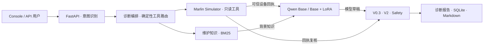

# PrintDiag-Agent

PrintDiag-Agent 将 3D 打印异常描述转成一份可追溯的检查报告。它结合 Marlin Simulator 的只读观测、维护知识和模型草稿，说明当前能判断什么、建议先检查什么、哪些原因仍需验证。


## 从故障描述到报告

- **设备读取**。MarlinClient 支持组件探测、快照采集和只读诊断。Console 运行时只通过允许的 GET 读取设备投影，区分模拟器、合成示例与离线状态。
- **诊断编排**。规则识别故障、状态查询或普通问答，选择允许的设备工具与 BM25 检索。Qwen3.5-4B Base 或 Base + LoRA 生成七字段草稿。
- **证据与安全**。V0.3 严格校验类型和字段，V2 区分用户描述、设备回执、RAG 背景和模型推测。Safety 拦截危险建议，人工复核内容在发布层遮蔽。
- **报告与评测**。FastAPI 和 Console 提供诊断、证据、SQLite 历史及 Markdown。独立 Harness 验证 F03 的注入、观测和恢复，并支持离线回归。



Console 依靠确定性工具路由。项目另有可选的 OpenAI-compatible Function Calling 接口，并有独立的 Mock 协议测试。 [架构与信任边界](docs/ARCHITECTURE.md)

## 五分钟离线演示

在源码仓库根目录执行。Windows PowerShell 和 CPython 3.13 已验证，默认绑定本机回环。

```powershell
py -3.13 -m venv .venv
.\.venv\Scripts\python.exe -m pip install -e ".[agent,dev]"
.\.venv\Scripts\python.exe -B scripts/run_console_demo.py --port 8010
```

打开 [AI 智能诊断](http://127.0.0.1:8010/console/diagnosis)，保持 V2 已勾选并提交：

> 打印外壁明显偏细，相邻走线出现规则空隙，材料仍持续流出。

页面显示“疑似挤出不足”及“证据不足”。展开技术详情查看检索依据，再从 **Demo 回放** 选 **Safety · 危险建议拦截**。进入 **诊断历史** 查看两份报告并导出 Markdown。每次 Demo 启动使用独立临时 SQLite。截图与结果来自合成示例，无 GPU、模型密钥、训练数据或模拟器依赖。 [完整演示](docs/DEMO_GUIDE.md) · [历史详情截图](docs/assets/console/v1-history.png)

如需显示模拟器真实读数，在已启动支持 HTTP 的 Marlin Simulator 后按指南开启 **Simulator 只读模式**。真实模型部署属于独立可选模式，需自行提供固定 Base、Adapter、部署环境、服务端授权和独立预算。 [三种模式及部署](docs/DEMO_GUIDE.md) · [复现命令](docs/REPRODUCIBILITY.md)

## 验证结果

| 范围 | 已完成证据 |
| --- | --- |
| M1 · 模拟器通信 | 组件探测、定时快照、只读查询与原始记录校验 |
| M2 · 故障实验 | R5 配置上的 F03 X Min 持续触发与恢复，V2 实验验收 10/10 |
| M3–M5 · 诊断与系统 | 证据核查、Safety、独立评测、FastAPI、Console、History 与 Markdown |
| 最终离线回归 | 937 项可移植和 111 项历史依赖测试通过，后者需要授权的 Git 外证据 |
| 浏览器 | P10-10 历史 23 项检查通过，最终 Mock Demo 另有 6 项本机浏览器检查通过 |
| Safety | 原冻结 103 条标签案例通过，覆盖危险指令、放行及需人工复核 |
| 真实模型联调 | P10-9B 单一 B01 输入的 Base 和 LoRA 各一次，2/2 请求完成 |

历史 30 样本、四组模式的全样本故障类别准确率分别为 **6.7% / 10.0% / 3.3% / 10.0%**。该结果表明类别映射和诊断质量仍需改进。两次 B01 只验证链路可运行。 [评测口径与限制](docs/EVALUATION_SUMMARY.md)

## 范围与后续

F03 结论适用于验收过的 R5 实验配置。F01/F02 的真实故障注入、物理打印机适配和跨设备准确率尚未验证。设备读数和文字描述冲突时保留不确定性。模拟器人工控制为单独的本地功能，默认关闭。诊断工具始终只读。

[复现与测试](docs/REPRODUCIBILITY.md) · [评测口径](docs/EVALUATION_SUMMARY.md)
