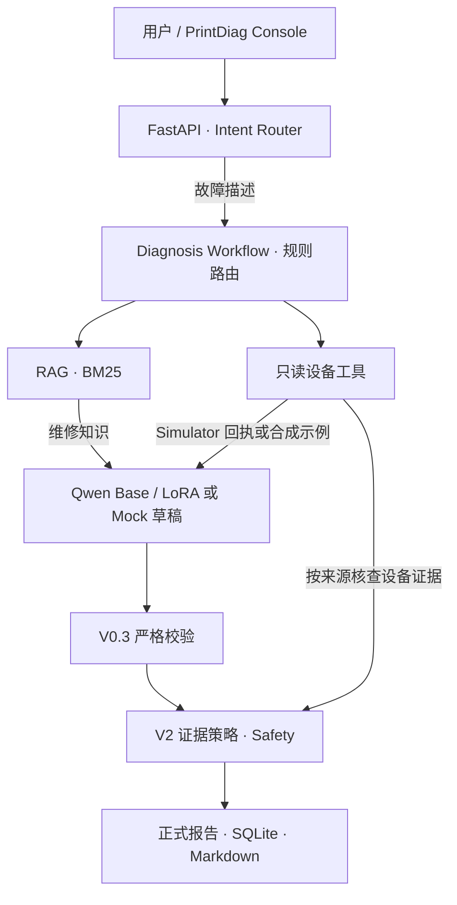
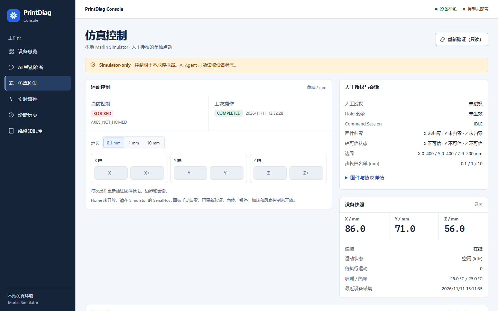
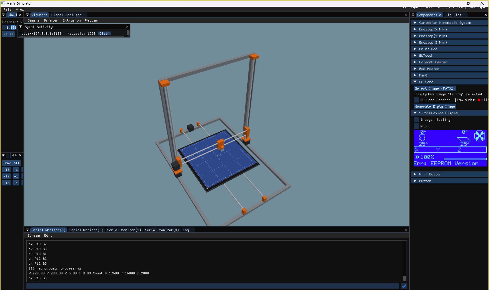

# PrintDiag-Agent

**Evidence-first AI Diagnostics for FDM 3D Printing**

面向 FDM 3D 打印的证据驱动型 AI 故障诊断系统。

`Python 3.13` · `FastAPI` · `Qwen3.5-4B` · `LoRA` · `RAG / BM25` · `Marlin`

[离线 Demo](#五分钟离线演示) · [系统架构](#系统架构) · [功能截图](#功能截图) · [模型与资源](#复现与资源)


*离线 Demo · 无需 GPU。报告保留「疑似挤出不足」和「证据不足」，并列出判断依据和两项检查。*

## 项目简介

输入「外壁线条偏细」或「打印件层错位」等现象，PrintDiag-Agent 通过只读工具获取可用的 Marlin Simulator 状态，检索维修知识，再生成带来源和检查建议的结构化报告。**模型生成的是待验证的草稿。** 报告能否确认故障，取决于与本轮问题相关的可信设备证据。

## 核心功能

| 模块 | 能做什么 |
| --- | --- |
| **AI 诊断** | Qwen3.5-4B Base 或 Base + LoRA 生成七字段草稿，报告展示依据、检查建议和待确认项。 |
| **维修知识检索** | BM25 检索本地维修语料，保留知识片段及其来源。 |
| **设备接入** | 通过允许的 GET 读取模拟器状态与组件，保留 Simulator、合成示例或离线来源。 |
| **证据与安全** | V0.3 校验结构和类型，V2 核查工具回执，Safety 拦截危险建议并遮蔽待人工复核的内容。 |

Console 支持诊断回放、实时事件、SQLite 历史和 Markdown 导出。

## 五分钟离线演示

已在 Windows PowerShell 和 Python 3.13 验证。首次安装需能获取 Python 依赖，演示运行无需 GPU、模型权重、API Key 或 Marlin Simulator。

```powershell
git clone https://github.com/Dannyzhou0512/PrintDiag-Agent.git
Set-Location PrintDiag-Agent
py -3.13 -m venv .venv
.\.venv\Scripts\python.exe -m pip install -e ".[agent,dev]"
.\.venv\Scripts\python.exe -B scripts/run_console_demo.py --port 8010
```

打开 [Console 诊断页](http://127.0.0.1:8010/console/diagnosis)，保持 **V2 证据策略**勾选，提交：

> 打印外壁明显偏细，相邻走线出现规则空隙，材料仍持续流出。

展开 **技术详情**查看证据和检索引用。通过 **Demo 回放 → Safety · 危险建议拦截**查看安全发布结果，再到 **诊断历史**导出 Markdown。演示使用固定 Mock 草稿和合成读数，实际运行检索、校验、安全发布及历史记录流程。每次启动创建独立的临时 SQLite。 [演示指南](docs/DEMO_GUIDE.md)

## 系统架构



主 Console 由规则决定工具调用。状态查询走独立的只读路径。V2 依据执行器返回的回执核查设备证据，RAG 片段用于解释和排查。另有独立的 OpenAI-compatible Agent API 及 Function Calling Mock 协议测试。 [完整架构与信任边界](docs/ARCHITECTURE.md)

## 功能截图

[诊断报告](docs/assets/console/v1-diagnosis.png)在页首展示。以下历史截图来自同类离线 Demo，模拟器相关页面来自既有本地演示。


*诊断历史 · 按状态、来源或模型筛选，并导出带判断依据的报告。*

<details>
<summary>设备总览与仿真控制</summary>


*设备总览 · 查看模拟器来源、温度、三轴坐标、限位和运动队列。*



*仿真控制 · 查看轴归零状态、人工授权及动作拦截原因。人工控制为独立功能，默认关闭。*

</details>

<details>
<summary>实时事件与维修知识库</summary>


*实时事件 · 按设备、诊断和控制审计筛选。*


*维修知识库 · 按现象或部件检索，查看片段与来源。*

</details>



*Marlin Simulator · 本地模拟器原生界面，包含虚拟打印机、组件与固件串口日志。*

## 模型与评测

在云端 **RTX 5090（32 GB）** 上使用 LLaMA-Factory 对 **Qwen3.5-4B** 做 LoRA SFT。训练使用 **240 条训练样本、30 条验证样本**，完成 2 个 Epoch、60 个优化步。另留 30 条独立测试样本。

<details>
<summary>训练配置</summary>

BF16，序列上限 1,024 Tokens。LoRA Rank 16、Alpha 32、Dropout 0.05，目标层 `q_proj` 和 `v_proj`。学习率 `1e-4`，Cosine 调度，Warmup 5%，每设备 Batch 1，梯度累积 8，Seed 42。本次训练计时约 16 分钟，末轮验证 Loss 0.9941。

</details>

| 历史留出评测 | 类别正确数（每组 30 条） |
| --- | ---: |
| Base | 2/30（6.7%） |
| Base + RAG | 3/30（10.0%） |
| LoRA | 1/30（3.3%） |
| LoRA + RAG | 3/30（10.0%） |

未映射或格式无效的结果均计为错误。该结果尚不足以证明 LoRA 提升了分类准确率。 [评测口径与结构合规结果](docs/EVALUATION_SUMMARY.md)

- **真实模型联调**。P10-9B 在同一 B01 输入上各运行一次 Base、Base + LoRA，2/2 请求完成，两份报告均保留「证据不足」。这里衡量推理接入与报告发布。
- **设备实验**。R5 模拟器上的 F03 X Min 持续触发、观测和恢复通过独立实验验收 10/10。
- **证据与安全**。V2 在冻结回放中识别 22/22 条有效证据不足样本，103 条 Safety 标签用例通过。测试和浏览器验证范围见 [评测汇总](docs/EVALUATION_SUMMARY.md)。

## 运行模式

| 模式 | GPU / 模拟器 | 数据与模型 | 用途 |
| --- | --- | --- | --- |
| 离线 Mock Demo | 均无需 | 合成读数、固定草稿与回放 | 演示完整诊断和导出流程 |
| Marlin Simulator 只读 | 无需模型 GPU，需本地模拟器 | 实时模拟器读数，模型生成关闭 | 检查设备连接、来源与状态 |
| 云端 Qwen | 云端 GPU，模拟器可选 | 明确来源的设备或合成数据，Base / LoRA 真实生成 | 联调部署与有预算的评测 |

模拟器只读模式要求支持 `/ping`、`/state`、`/idle` 和限位组件读取的本地构建，默认设备地址为 `127.0.0.1:8100`。接口不可用时显示离线。公开仓库未附带验收用的模拟器可执行文件。 [只读启动步骤](docs/DEMO_GUIDE.md#单独展示真实模拟器读数) · [云端部署说明](docs/DEMO_GUIDE.md#可选云端真实推理)

## 复现与资源

| 资源 | 当前可获取范围 |
| --- | --- |
| Console 与离线样例 | 随源码发布。[安装与测试](docs/REPRODUCIBILITY.md) · [演示指南](docs/DEMO_GUIDE.md) |
| RAG 维修语料 | 16 个项目自编片段，随包本地检索。[基础 JSON](src/printdiag/rag/knowledge/maintenance/printdiag-v01.json) · [扩展 JSONL](src/printdiag/rag/knowledge/maintenance/printdiag-p10_3.jsonl) |
| Qwen3.5-4B 基础权重 | 官方发布，模型页标注 Apache-2.0。[模型页](https://huggingface.co/Qwen/Qwen3.5-4B) · [P10-9B 固定快照 `851bf6e`](https://huggingface.co/Qwen/Qwen3.5-4B/tree/851bf6e806efd8d0a36b00ddf55e13ccb7b8cd0a) |
| PrintDiag LoRA Adapter | 权重和配置暂未公开。复现同一 LoRA 推理需要该 Adapter 及其匹配的推理配置。 |
| 训练和评测 | 合成样例与[评测汇总](docs/EVALUATION_SUMMARY.md)已公开。原始训练数据、历史评测记录及模型原始输出独立保管。 |

## 当前限制与后续

- F03 的验收限于已验证的 R5 仿真配置。F01/F02 尚未完成正式实验验收，实体打印机尚未接入。后续考虑 Marlin USB 串口及其他固件的只读适配。
- 类别识别仍需改进，维修语料规模有限。后续扩展带来源和机型信息的维修知识，冻结更有代表性的评测集。
- 离线 Demo 验证流程和安全边界。真实模型质量需在独立样本上评测，并分别统计分类、证据引用和推理开销。

## 许可证与致谢

项目源码和知识语料公开可读，仓库尚未声明开源许可证。上游资源采用各自的发布许可。感谢 [Qwen](https://huggingface.co/Qwen/Qwen3.5-4B)、[Marlin](https://github.com/MarlinFirmware/Marlin) 与 [LLaMA-Factory](https://github.com/hiyouga/LlamaFactory)。
