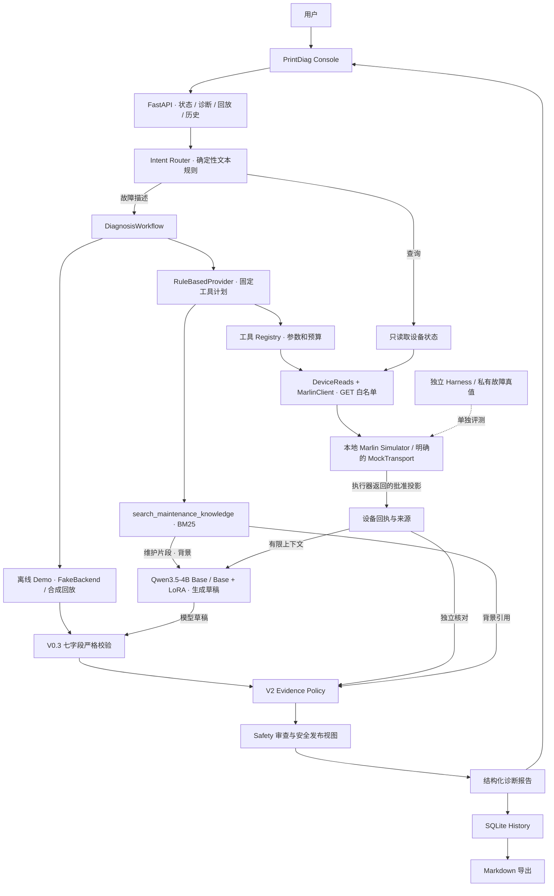

# PrintDiag-Agent 技术架构

## 状态与接口

| 部件 | 职责 |
| --- | --- |
| FastAPI Console | `GET /api/device/status` 读取批准投影，`POST /api/ask/stream` 返回 NDJSON 阶段与报告，`POST /api/demo/diagnose` 回放，`GET /api/history` 查询持久化报告。诊断提交是应用请求。 |
| Intent Router / Workflow | 问候和纯设备状态不进入模型管线。故障进入诊断。Console 的工具计划由 `RuleBasedProvider` 决定，工具执行器约束参数、轮数、预算与来源。 |
| 工具 | `read_printer_state`、`read_endstop_components`、`search_maintenance_knowledge`。DeviceReads 仅允许指定来源、Host 与路径精确匹配的 GET，请求无额外正文，关闭代理与重定向。 |
| 证据 | `LIVE_SIMULATOR` 有显式模拟器来源，`SYNTHETIC_FIXTURE` 只代表示例，`UNKNOWN` 保留未知。物理打印机接入尚未实现。RAG 与模型的工具标记无权生成可信回执。 |
| 质量发布 | V0.3 保留未知类别并拒绝错误字段类型。V2 允许明确异常形成待验证假设，检查回执相关性。Safety `blocked` 和 `review_required` 对危险文字遮蔽。用户默认看到白名单投影，技术详情折叠。 |
| 隔离 | F03 的注入器、私有真值及 GPIO 追踪由 Harness 单独管理。Console 的人工仿真控制有独立开关和会话门禁，默认关闭。 |

可选 Agent API 的 Function Calling Provider 属于另一入口。主 Console 架构如图。 [运行模式](DEMO_GUIDE.md)
